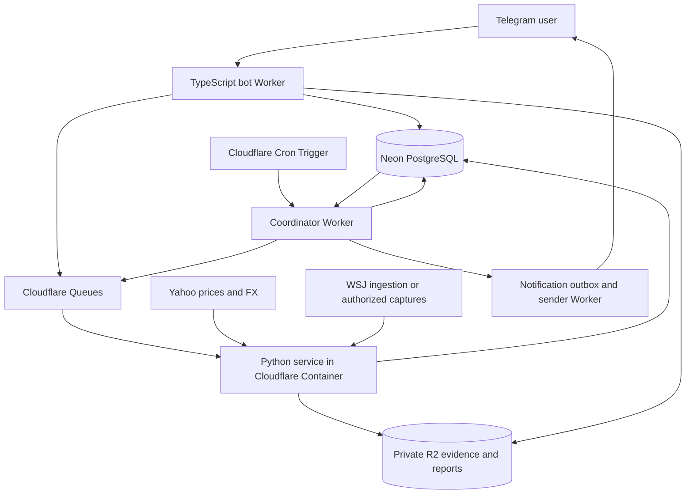

# screenerX cloud production plan

Prepared October 12, 2026. This is an implementation plan, not a deployed service.

Update: the user subsequently authorized yfinance company financials across the universe. The implemented Telegram release is documented in [telegram-bot.md](telegram-bot.md); its financial provider is explicitly yfinance. WSJ-only statements below describe the original source decision and are superseded for that release. Daily market collection/subscriptions remain planned rather than deployed.

## Recommended architecture

Use Cloudflare Workers for the Telegram webhook, read API, scheduled orchestration and queue consumers. Run the existing Python ingestion/calculation engine in a Cloudflare Container. Store normalized records, jobs and report metadata in Neon PostgreSQL. Retain raw source captures and CSV/JSON reports in private Cloudflare R2.

Cloudflare Containers support existing runtimes, native libraries and filesystem-dependent applications, and require a Workers Paid plan. This fits the installed yfinance dependency graph, which includes pandas, numpy, lxml and curl_cffi. Python Workers are available, but their Pyodide/package compatibility must be evaluated separately; do not promise that the current CLI will run there unchanged. [Containers documentation](https://developers.cloudflare.com/containers/), [Python package compatibility](https://developers.cloudflare.com/workers/languages/python/packages/).

Use Neon through Hyperdrive with a compatible PostgreSQL driver in Workers; the Python container uses its own pooled PostgreSQL connection with a separate database role. Keep migrations and model processing independent of bot handlers. An HTTP serverless driver is an alternative if the initial Worker query patterns are simple; do not combine it with Hyperdrive as though they are the same connection path. [Cloudflare Neon integration](https://developers.cloudflare.com/workers/databases/third-party-integrations/neon/).

## Scope and the WSJ dependency

Initial product: all listed IDX common equities, daily closing-price research, WSJ-based DDM/RIM/EVA, per-company detail, watchlists and daily Telegram digests. Track the complete listing universe even when individual companies lack enough data. Distinguish common shares from warrants, rights, ETFs and other instruments before ranking. Retain IPO, suspension, delisting and symbol-change metadata rather than silently dropping companies.

Company financials must remain WSJ-sourced. Yahoo supplies OHLCV and FX only; it must not fill missing company statements. Broker flow remains ON_HOLD until a complete usable provider is integrated. Existing model estimates remain unreviewed; hosting does not change their review status or make current trade plans qualified.

The current WSJ integration is not an autonomous production feed. Direct requests returned HTTP401, and calculations used captured public WSJ table views with variable freshness. Moving the same requests to Cloudflare is not evidence that access will work. Source availability is the first implementation gate:

1. Establish an accessible, supported WSJ data-ingestion route or authorized statement exports.
2. Until then, support authenticated WSJ capture/import into R2 and versioned normalization into Neon. Reuse the latest usable snapshot with its actual age visible; never label it as freshly fetched.
3. Show annual period, retrieval time, known publication time when available, currency, units and missing-model reasons. If the financial age exceeds the profile limit, omit the valuation while retaining technical research.
4. Do not describe the service as fully automatic WSJ valuation refresh until scheduled refresh has worked repeatedly with the intended access route.

Similarly, the all-IDX universe needs a maintained, dated listing source. Prefer an official IDX listing/security reference source with usable access; an authenticated versioned exchange-list import is the fallback. A brokerage/public universe can be cross-checked, but is not automatically an authoritative common-equity eligibility list.

## Storage model

Use PostgreSQL NUMERIC for financial amounts and modeled prices; BIGINT for Telegram IDs; DATE for trading/statement dates; TIMESTAMPTZ for UTC events. Render schedules in Asia/Jakarta. Missing fields are NULL, never zero. Keep source-specific facts distinct from forward assumptions.

| Table/group | Responsibility and key constraints |
|---|---|
| securities, security_events, universe_versions, universe_members | Exchange-qualified identity, instrument type, listing history and immutable membership per run |
| market_sessions | Observed or verified exchange sessions; separate from weekday guesses |
| price_bars | Symbol/session/provider/adjustment basis, OHLCV, turnover estimate flag and source reference |
| financial_snapshots, financial_facts | WSJ source URL, statement date, publication/retrieval time, currency, units, original row labels and versioned normalized facts |
| fx_rates | Base/quote direction, observation date, provider, value and evidence reference |
| profiles | Immutable screening/valuation JSON, content hash, model version and creation time |
| runs, run_members, jobs | Universe and input versions, date/profile, job leases, attempts, outcomes and per-company failure reasons |
| valuation_results, technical_results, shortlist_entries | Per-run outputs, individual methods, scenario values, applicability and quality flags |
| evidence_objects, reports | Private R2 keys, hashes, content type, source linkage and report generation status |
| telegram_users, watchlists, subscriptions | Allowed users/chats and explicit digest/watchlist subscriptions |
| telegram_updates, notification_outbox | Unique inbound update IDs, outbound report/subscriber keys, attempts and Telegram message IDs |

Price/source revisions create a retained version instead of destroying historical evidence. A run binds the exact universe, price versions, financial snapshots, FX inputs, code version and assumption profile. Do not infer historical publication availability from today's retrieved statements. R2 holds original captures/large reports; Neon holds queryable facts and references.

## Daily and financial-refresh workflow

Proposed price refresh: 18:30 Jakarta on weekdays, corresponding to `30 11 * * 1-5` UTC. The coordinator still checks actual market sessions and skips exchange holidays or an unchanged decision date. Cloudflare Cron expressions operate in UTC. Financial discovery/refresh runs weekly and after detected statement updates, within the source's usable access and request allowance. [Cron Trigger documentation](https://developers.cloudflare.com/workers/configuration/cron-triggers/).

1. Freeze the dated all-IDX universe and the chosen immutable model profile.
2. Create a run and per-company jobs transactionally, with an outbox for dispatch. Enforce a unique run request/idempotency key to prevent a Cron retry and manual request creating duplicates.
3. Dispatch bounded batches through Queues. Initially use small batches and low provider concurrency, then tune using measured runtime and source response limits. Never run the exchange-wide fetch inside a Telegram webhook or one Cron invocation.
4. The Python service leases jobs and ingests incremental price/FX data. Bootstrap each company with at least the configured history; later jobs normally fetch recent sessions and corrections. New listings with insufficient history remain visible as excluded.
5. Resolve the latest suitable WSJ snapshot independently. A WSJ refresh failure can retain an explicitly dated usable snapshot; it cannot inject Yahoo company facts. Reject stale, mismatched-period, wrong-currency or invalid-unit inputs.
6. Calculate indicators and valuations from versioned inputs. Record per-method reasons instead of discarding companies or fabricating ten entries.
7. Finalize after all members reach a terminal state or a defined deadline. Publish COMPLETE/PARTIAL/FAILED coverage and advance the latest-report pointer only according to the documented policy. Keep the last complete run accessible separately from a newer partial run.
8. Store report artifacts in R2 and create outbox notifications. Send subscribers one digest identifying the run date, coverage and missing data. Retries of the same run must not create a new digest entry.

Cloudflare Queues have at-least-once delivery, so job processing must be idempotent. Use unique job keys, leases, checkpointed progress and bounded retries; do not rely on exactly-once transport. A lost container response after committing results should be safely retried. Dead-letter repeatedly failing temporary jobs. Authentication/challenge failures are source-access failures, not an excuse for repeated identical requests. [Queue delivery guarantees](https://developers.cloudflare.com/queues/reference/delivery-guarantees/).

Large payloads travel through R2 references, not queue messages. Persist progress in Neon, not container local disk. Account for the queue invocation duration when choosing batch size; use another message/checkpoint for work that would exceed it. [Workers limits](https://developers.cloudflare.com/workers/platform/limits/).

## Telegram interface

Start with a private bot restricted to the owner's Telegram user IDs and approved chat IDs. Public/multi-user access is a later product decision; scope watchlists and subscriptions by user from day one.

| Command | Proposed behavior |
|---|---|
| /start, /help | Explain commands, source policy and subscription setup |
| /top | Latest completed or explicitly labeled partial shortlist, price date and coverage |
| /stock TLKM | Close/indicators, available DDM/RIM/EVA, assumptions and missing-model reasons |
| /valuation TLKM | Statement period, WSJ links, share-count basis, scenarios, MOS and dispersion |
| /coverage | Listed universe, downloaded/estimated/excluded/failed counts and source freshness |
| /watch add TLKM, /watch remove TLKM | Change the caller's watchlist |
| /subscribe, /unsubscribe | Opt into/out of daily digests |
| /status | Last complete run, current progress, failures and WSJ refresh state |
| /run | Owner-only asynchronous refresh with job/run ID; no blocking full-market work |
| /report | CSV/report delivery or a short-lived authenticated artifact link |

Serve routine commands from stored results. Validate Telegram's webhook secret header, persist/deduplicate `update_id`, enqueue processing and return HTTP200 promptly. Use an inbound transactional outbox so durable acceptance cannot silently lose a command before queue dispatch. Reject unauthenticated requests and restrict expensive commands. Store the bot token and database secrets outside the repository. [Telegram webhook API](https://core.telegram.org/bots/api#setwebhook).

Rate-limit outbound delivery and honor Telegram retry_after responses. Record message IDs where available. Telegram does not provide a general exactly-once send guarantee: an ambiguous network timeout after delivery can still cause a duplicate. Use a durable outbox, explicit uncertain-delivery status and a documented retry policy rather than promising perfect deduplication. Escape user-provided symbols/text before Telegram formatting.

## Code changes and deployment layout

Retain the deterministic Python calculations in screenerx/engine.py and screenerx/valuation.py. Extract CLI filesystem/print/exit behavior into adapters; introduce storage and source interfaces so jobs can run without local CSV directories. Preserve the existing source-validation rules and golden outputs.

Proposed new directories: workers/bot/, workers/coordinator/, workers/notifications/, services/engine/, db/migrations/, infra/ and integration-tests/. Use a TypeScript Worker stack, a small Python HTTP job service and a pinned container image. Choose SQL migrations and a shared schema/versioned job contract before implementing handlers. A container job API is private to Worker service routing, not a public arbitrary-code endpoint.

Keep separate development, staging and production Neon branches/databases, R2 buckets, queues, bot tokens and secrets. Use migration, integration-test and staged-deploy CI steps. Workers query through a scoped role; the engine writes market/model records through another role; migrations use a separate role. Protect administrative WSJ imports and artifact download endpoints. Redact bot tokens, connection strings and source-access secrets from logs.

## Delivery phases and acceptance gates

| Phase | Deliverable | Acceptance gate |
|---|---|---|
| 1. Source and universe validation | All-IDX reference import, WSJ access/import contract, source freshness policy and batch measurements | Real sample coverage across banks/nonbanks/new listings; WSJ refresh mode honestly demonstrated |
| 2. Neon/R2 foundation | Schema/migrations, versioned inputs, private evidence storage, Python storage adapters | Existing 15-symbol outputs reproduced from stored records; reload/recompute without source relabeling |
| 3. Cloud pipeline | Python container, coordinator, queue leases/retries, schedules and run finalization | Full imported IDX universe processed; partial failures, process restarts and duplicated jobs preserve correct coverage |
| 4. Telegram bot | Authenticated webhook, stored-result commands, owner refresh and subscriptions | Unauthorized commands rejected; retried updates do not create duplicated jobs/subscriptions |
| 5. Operations and release | Outbox delivery, alerts, dashboards, migrations/rollback and production secrets | At least five successful real trading-session cycles; source errors, stale inputs, database outage and rate limits exercised |

A practical first release is a private bot that screens daily prices across all IDX companies and uses explicitly dated WSJ snapshots for available valuations. Fully autonomous WSJ refresh is a separate gate, not a promise hidden inside the infrastructure rollout. Scope can expand only after measured source coverage and job throughput justify it.

## Operations, costs and remaining decisions

Track run duration, universe coverage, oldest/median financial age, model availability by method, provider401/429 failures, queue backlog, container restarts, database errors and Telegram delivery failures. Alert the owner on failed/late runs and a missing expected session. Budget for Workers Paid/Containers, R2 storage/operations, Neon compute/storage and the usable financial-data source. Retain raw captures according to a defined retention policy and prune unused artifacts without erasing referenced evidence. Set concurrency and spending limits before exchange-wide backfills; estimate cost from measured jobs rather than promising free-tier operation.

Proposed defaults pending product preferences: private owner bot, daily18:30 Jakarta price refresh, weekly financial-refresh checks, all-IDX common-equity scope and notifications only to explicit subscribers. Decisions needed before implementation: accepted WSJ access/import route, universe reference source, Cloudflare/Neon account and region setup, desired budget/retention, and whether the bot should become public. No credentials should be pasted into chat; provision them as deployment secrets when implementation reaches that stage.
